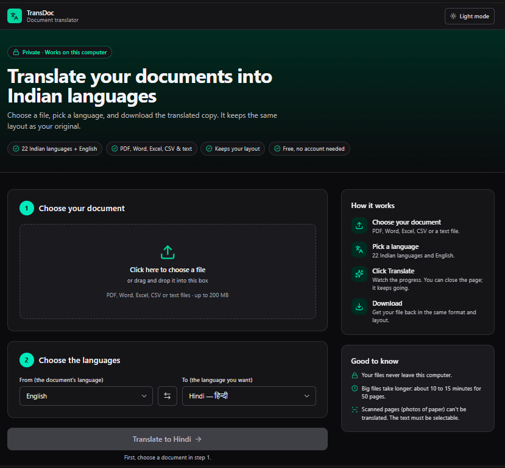
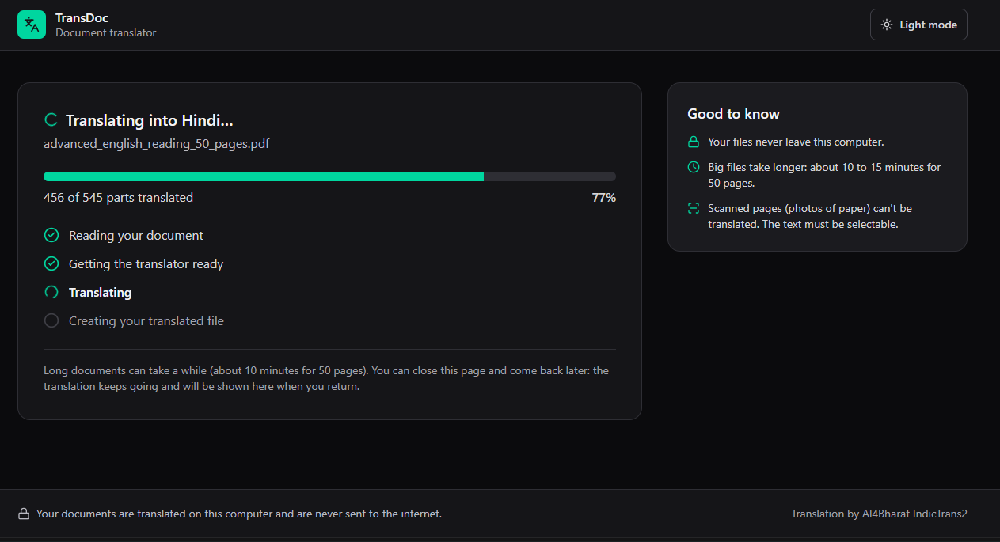
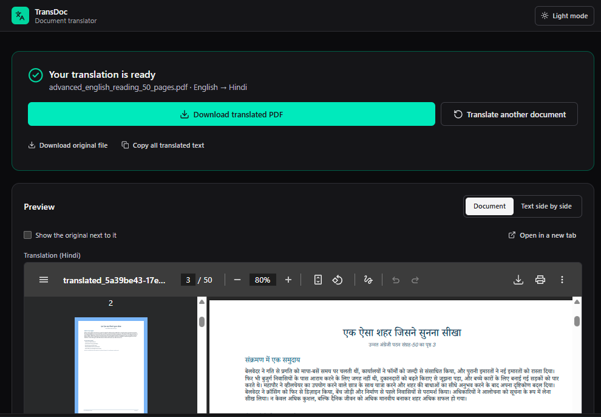
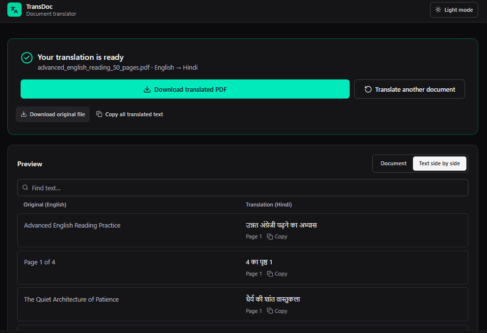

# TransDoc: Document Translator

TransDoc translates your documents into **Indian languages**, right on your own computer.

- 📄 Works with **PDF, Word, Excel, CSV and text files**
- 🇮🇳 Translates into **22 Indian languages** (and English)
- 🎨 Keeps your document's **layout**: pictures, tables, and formatting stay in place
- 🔒 **Private**: your documents never leave your computer
- 💸 **Free**: no account, no subscription, no API key



---

## What you need

1. **A computer** with Windows, Mac or Linux.
   - At least **8 GB of memory (RAM)**. 16 GB is better.
   - About **10 GB of free disk space**.
2. **Docker Desktop**, a free program that runs TransDoc for you.
   Download it from **https://www.docker.com/products/docker-desktop/** and install it like any other program.
3. **Internet, for the first start only.** TransDoc downloads its translation brain (about 1 GB) one time.
   After that it works fully offline.

---

## Start TransDoc (first time)

**Step 1: Open Docker Desktop.**
Start Docker Desktop from your Start menu (or Applications on a Mac). Wait until it says **"Engine running"**
(a green light at the bottom left).

**Step 2: Open a command window in the TransDoc folder.**
- **Windows:** open the TransDoc folder (for example `D:\translate_pdf`) in File Explorer. Click the address bar
  at the top, type `cmd`, and press **Enter**. A black window opens.
- **Mac:** open the **Terminal** app, type `cd ` (with a space), drag the TransDoc folder into the window, and press **Enter**.

**Step 3: Type this command and press Enter:**

```
docker compose up -d --build
```

The first time this takes **5 to 10 minutes**. Lots of text scrolls by; that's normal.
It's finished when you see lines ending in **"Started"**.

**Step 4: Open TransDoc in your web browser:**

👉 **http://localhost:3000**

Bookmark this page. That's it, TransDoc is running!

> The very first translation may take a few extra minutes while TransDoc downloads its translation brain.

---

## How to translate a document

1. **Choose your document.** Click the big box (or drag your file onto it).
2. **Choose the languages.** "From" is the language your document is in now. "To" is the language you want.
3. **Click "Translate".** A progress bar shows how far along it is.

   

4. **Download.** When it says **"Your translation is ready"**, click the big **Download** button to get your
   translated file. You can also look at it right on the page first.

   

   Click **"Text side by side"** to compare the original and the translation line by line:

   

### Good to know

- ⏱️ **Big files take time.** A 50-page PDF takes about **10 to 15 minutes**.
- 📚 **You can translate several documents at once.** After clicking Translate, just choose the next file.
  All your documents appear under **"Your translations"** on the right.
- 🚪 **You can close the page.** Translations keep going. Open **http://localhost:3000** again later to see them.
- 🏠 **Go back to the start** at any time with the **"Back to home"** button or by clicking the **TransDoc** logo.
- ✋ **Started the wrong one?** Click **Stop** next to it under "Your translations".
- 🌙 **Dark mode:** use the button at the top right.
- 🗑️ Translated files are kept for **24 hours**, then deleted automatically. Download what you need.

---

## Everyday use

Open a command window in the TransDoc folder (see Step 2 above) and type one of these:

| I want to… | Type this |
| :--- | :--- |
| **Start** TransDoc | `docker compose up -d` |
| **Stop** TransDoc | `docker compose stop` |
| **Update** TransDoc after getting new files | `docker compose up -d --build` |

> 💡 Docker Desktop must be open before you start TransDoc.
> If your computer restarts, open Docker Desktop and TransDoc starts again by itself.

---

## Something not working?

| What you see | What to do |
| :--- | :--- |
| The page **http://localhost:3000** won't open | Make sure **Docker Desktop** is open and says "Engine running". Then type `docker compose up -d` in the TransDoc folder and wait 1 minute. |
| **"Can't connect to the translator"** | TransDoc is still starting. Wait a minute and click **"Try again"**. |
| **"Reconnecting…"** during a translation | Nothing to do. TransDoc briefly restarted, and your translation continues by itself. |
| **"This file can't be used"** | Only PDF, Word (.docx), Excel (.xlsx / .xls), CSV and text (.txt / .md) files work. Old Word files (.doc) must be saved as .docx first. |
| **"No selectable text was found"** | The PDF is a **scan** (a photo of paper). TransDoc can only translate PDFs whose text you can select and copy. |
| **"The PDF is password-protected"** | Remove the password (open it, then "Save as" without a password) and try again. |
| **"This file is too large"** | The limit is 200 MB. Split the file, or raise the limit (see "Settings" below). |
| **"The translator isn't ready on this computer"** | The first start needs internet to download the translation brain. Connect to the internet and restart TransDoc. If it continues, ask your IT person to look at the "Show details" text. |
| The page looks old or strange after an update | Press **Ctrl + F5** (Mac: **Cmd + Shift + R**) to refresh it. |
| Docker Desktop is stuck or says "Engine stopped" | Close Docker Desktop completely (right-click its icon near the clock, then **Quit**), open it again, and wait for "Engine running". |

---

## Settings (optional)

You can change a few settings in the file **`backend\.env`**. Open it with **Notepad**, change the number, and
**save**. Then type `docker compose up -d` in the TransDoc folder.

| Setting | What it does | Current value |
| :--- | :--- | :--- |
| `MAX_UPLOAD_MB` | Largest file you can upload, in MB | `200` |
| `MAX_PDF_PAGES` | Most pages a PDF may have | `1000` |
| `MAX_PARALLEL_JOBS` | How many documents translate at the same time | `4` |
| `JOB_TTL_HOURS` | How many hours translated files are kept | `24` |
| `TRANSLATION_NUM_BEAMS` | Quality vs. speed: `4` = best quality, `1` = about **2× faster** (slightly simpler wording) | `4` |

> Only change the number after the `=` sign. Don't add spaces or quotes.

---

## Languages

**English ↔ Indian languages:**
Hindi (हिन्दी), Bengali (বাংলা), Tamil (தமிழ்), Telugu (తెలుగు), Marathi (मराठी), Gujarati (ગુજરાતી),
Kannada (ಕನ್ನಡ), Malayalam (മലയാളം), Punjabi (ਪੰਜਾਬੀ), Odia (ଓଡ଼ିଆ), Urdu (اردو), Assamese (অসমীয়া),
Sanskrit (संस्कृतम्), Maithili (मैथिली), Nepali (नेपाली), Konkani (कोंकणी), Sindhi (سنڌي), Kashmiri (كٲشُر),
Dogri (डोगरी), Bodo (बड़ो) and Santali (ᱥᱟᱱᱛᱟᱲᱤ).

- **English → any Indian language** works right away.
- **Indian language → English**, and **between two Indian languages**, need a free one-time setup by your
  IT person (see "One-time setup for other translation directions" below).

## What happens to each file type

| Your file | What you get back |
| :--- | :--- |
| **PDF** | The same PDF with the text replaced in place. Pictures, colors, lines and page layout stay. |
| **Word (.docx)** | The same document with formatting, pictures, tables, headers and footers kept |
| **Excel (.xlsx / .xls)** | The same workbook. Formulas, numbers and dates are untouched; only text is translated. (Old .xls files come back as .xlsx.) |
| **CSV** | The same rows and columns, ready to open in Excel |
| **Text (.txt / .md)** | The same lines and paragraphs |

---
---

## For IT / developers

Everything below is technical detail for whoever installs or maintains TransDoc.

### Architecture
- **Frontend:** Next.js (`frontend/`), served on port 3000. The browser calls `/api/*`, which Next.js proxies to
  the backend.
- **Backend:** FastAPI (`backend/`), port 8000, API docs at http://localhost:8000/docs.
- **Translation:** [AI4Bharat IndicTrans2](https://github.com/AI4Bharat/IndicTrans2) running locally through
  Hugging Face transformers. No external translation APIs are used; if the model can't run, the job fails with an
  explanation.
- **Jobs:** `POST /api/translate` returns a `job_id`. Then:
  - `GET /api/jobs/{id}` returns status and progress.
  - `DELETE /api/jobs/{id}` stops the job.
  - `GET /api/download/{id}` downloads the result.

  Jobs run in parallel (`MAX_PARALLEL_JOBS`). Model inference takes FIFO turns batch by batch, so every job
  advances. Jobs are saved to disk, checkpointed after each batch, and **resume automatically after a restart**.

### One-time setup for other translation directions
English → Indic uses a public copy of `ai4bharat/indictrans2-en-indic-dist-200M`. It was verified byte-identical
to the official repo (weights and model code) and is pinned to that commit, so no token is needed.

Indic → English and Indic → Indic use the official repos, which are gated on Hugging Face (approval is
automatic):
1. Sign in at https://huggingface.co and click **"Agree and access repository"** on
   [indictrans2-indic-en-dist-200M](https://huggingface.co/ai4bharat/indictrans2-indic-en-dist-200M) and
   [indictrans2-indic-indic-dist-320M](https://huggingface.co/ai4bharat/indictrans2-indic-indic-dist-320M).
2. Create a **read** token at https://huggingface.co/settings/tokens and add `HF_TOKEN=<token>` to `backend/.env`.
3. Run `docker compose up -d`.

The weights are cached in the `transdoc-hf-cache` Docker volume, so they download only once. To run fully offline
without Hugging Face, set `INDICTRANS2_*_MODEL` to local folders containing the weights.

> The model is loaded with `trust_remote_code=True`, so the model repository's Python files run locally.
> Pin `INDICTRANS2_*_REVISION` for any repository you have not verified.

### Version pins (important)
- `transformers>=4.40,<4.47`. IndicTrans2's model code needs the legacy KV-cache format. Newer versions fail with
  `Cache only has 0 layers` or `'NoneType' object has no attribute 'shape'`, and 5.x removed `transformers.onnx`.
- `PyMuPDF>=1.26,<1.27`. The 2.x line pulls in onnxruntime and crashed on import in testing.
- The backend needs **Python 3.10 to 3.13** (Docker uses 3.11). On 3.14, the `tokenizers` version required by
  transformers 4.46 has no wheel.

### Running without Docker
```bash
# Backend (from the repo root; Python 3.10-3.13)
python -m venv backend/venv
backend\venv\Scripts\activate          # macOS/Linux: source backend/venv/bin/activate
pip install -r backend/requirements.txt
python -m uvicorn backend.main:app --host 127.0.0.1 --port 8000

# Frontend (second terminal)
cd frontend
npm install
npm run dev                            # http://localhost:3000
```
On Windows, `requirements.txt` installs Microsoft's VC++ runtime DLLs into the venv (`msvc-runtime`), and the
backend loads them before PyTorch. This fixes `WinError 1114` on `c10.dll` without an admin install.

### Tests
```bash
cd backend
pip install -r requirements-dev.txt
python -m pytest
```
End-to-end tests marked `model` use the real model and are skipped, with the reason, if it can't be loaded.

### All settings (`backend/.env`, also used by Docker Compose)
| Variable | Purpose | Default |
| :--- | :--- | :--- |
| `INDICTRANS2_EN_INDIC_MODEL` / `_REVISION` | English → Indic model (repo id or local path) and pinned commit | verified public copy |
| `INDICTRANS2_INDIC_EN_MODEL`, `INDICTRANS2_INDIC_INDIC_MODEL` | Other directions (Indic → Indic falls back to pivoting through English) | official AI4Bharat repos |
| `HF_TOKEN` | Hugging Face read token, used only for downloading gated weights | empty |
| `PRELOAD_MODELS` | Models loaded at startup: `en-indic`, `indic-en`, `indic-indic` | `en-indic` |
| `MAX_PARALLEL_JOBS` | Documents processed at the same time | `4` |
| `TRANSLATION_BATCH_SIZE` / `TRANSLATION_NUM_BEAMS` | Inference batch size / beam width (`1` = greedy, about 2× faster) | `8` / `4` |
| `TORCH_NUM_THREADS`, `QUANTIZE_CPU_MODELS`, `MAX_LOADED_MODELS` | CPU threads, int8 quantization, models kept in memory | `0`, `0`, `2` |
| `MAX_UPLOAD_MB`, `MAX_PDF_PAGES`, `JOB_TTL_HOURS` | Upload size, PDF page and file retention limits | `50`, `300`, `24` (this install's `.env`: `200`, `1000`, `24`) |

> Keep comments in `.env` on their own lines. For an empty value followed by a comment, Docker reads the comment as
> the value.

### Known limitations
- Scanned PDFs are not OCR'd; they are reported to the user.
- Bold text in Indic scripts renders as regular weight in translated PDFs (MuPDF's built-in Indic fonts are regular only).
- Speed on CPU is about 1 sentence per second at `TRANSLATION_NUM_BEAMS=4`.
- The UI's old "tone" option was removed, because IndicTrans2 has no tone control.
